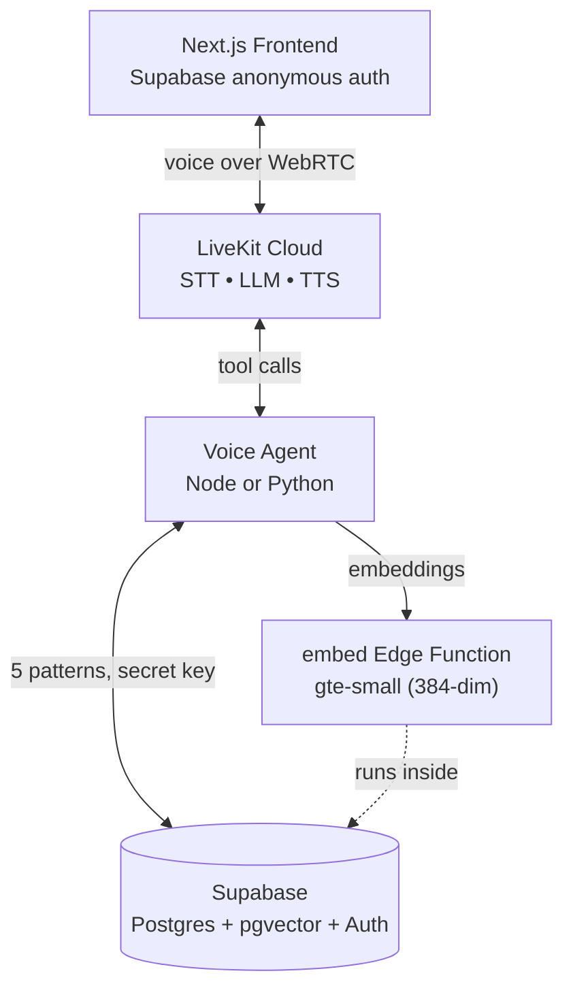

# LiveKit + Supabase Voice Agent Starter

A starter kit that wires a [LiveKit Agents](https://docs.livekit.io/agents) voice agent (Node or Python) into [Supabase](https://supabase.com) — Postgres with [pgvector](https://github.com/pgvector/pgvector), Supabase Auth, and Edge Functions — and pairs it with a [Next.js frontend](https://github.com/livekit-examples/agent-starter-react). The agent demonstrates five Supabase integration patterns: RAG over pgvector, agentic memory with Reciprocal Rank Fusion, pre-loaded user context, function-tool CRUD, and session report persistence. Embeddings are produced by a single shared [`embed` Edge Function](./supabase/functions/embed/index.ts) running the `gte-small` model (384-dim) directly inside Supabase.

This starter is **TypeScript-first**: the Node agent (`agent-ts/`) is the primary runtime and the docs lead with it. A fully equivalent Python agent (`agent-py/`) ships alongside it. For package-specific detail, see [`agent-ts/README.md`](./agent-ts/README.md), [`agent-py/README.md`](./agent-py/README.md), and [`frontend/README.md`](./frontend/README.md). This top-level README is the runbook for working with them together.

## Architecture



The frontend talks to LiveKit Cloud over WebRTC. LiveKit handles STT, LLM, and TTS; the agent is invoked through tool calls and reads or writes Supabase Postgres across all five integration patterns using the **secret key**. Embeddings for the vector and hybrid-search pipelines are generated by the `embed` Edge Function, which runs the `gte-small` sentence-transformer model inside Supabase and returns 384-dimensional vectors.

**The five Supabase integration patterns:**

1. **RAG over pgvector** — `search_knowledge` embeds the query through the `embed` Edge Function and calls the `match_knowledge` RPC, which orders the `knowledge` table by cosine distance (`embedding <=> query_embedding`) over an HNSW index.
2. **Agentic memory with Reciprocal Rank Fusion** — `remember` / `recall` / `forget` / `search_memories` / `list` operate on the `memories` table. `match_memories_hybrid` fuses a pgvector branch and a Postgres full-text (`tsvector`) branch via reciprocal rank fusion (k=60, weights 0.7 vector / 0.3 text), all inside a single SQL function. Memory slots are a `UNIQUE(user_id, memory_type)` upsert.
3. **Pre-loaded user context** — `preload_user` upserts the caller's profile (`last_seen_at`) and loads their prior memories before the LLM's first turn.
4. **Function-tool CRUD** — `lookup_order` reads the shared `orders` table by `order_id`; the same shape applies to any domain table you swap in.
5. **Session report persistence** — on disconnect, the agent writes a structured report to the `sessions` table using the secret key (no client-side insert path).

## Repo layout

```
supabase-hacker-starter/
├── package.json        # root orchestrator (scripts only, no workspaces)
├── README.md
├── LICENSE
├── .gitignore
├── agent-ts/           # PRIMARY: Node voice agent (pnpm + @livekit/agents + supabase-js)
│   ├── src/
│   ├── tests/
│   └── package.json
├── agent-py/           # Python voice agent (uv + LiveKit Agents + supabase-py)
│   ├── src/
│   ├── tests/
│   └── pyproject.toml
├── db/                 # seed script + sample data (secret key)
│   ├── seed.ts
│   └── data.ts
├── supabase/
│   ├── migrations/     # *.sql — schema, RLS policies, RPC functions, triggers, indexes
│   └── functions/
│       └── embed/      # gte-small Edge Function (Deno)
└── frontend/           # Next.js frontend (pnpm + LiveKit components + @supabase/ssr)
    ├── app/
    ├── components/
    └── package.json
```

The root `package.json` is a thin script runner backed by [`concurrently`](https://www.npmjs.com/package/concurrently). It shells into `agent-ts/` and `frontend/` via `pnpm --dir`, into `agent-py/` via `uv --directory`, and into Supabase via the [Supabase CLI](https://supabase.com/docs/guides/cli), so you never need to `cd` manually for day-to-day work. Pick a runtime with `pnpm dev:ts` or `pnpm dev:py`; only run one at a time, since both register under the same `AGENT_NAME`.

## Prerequisites

- Node.js 22+ and [pnpm](https://pnpm.io/) 10+ (Corepack auto-manages the pinned version when enabled)
- A [Supabase](https://supabase.com) project (the `gte-small` Edge Function and pgvector are available on the free tier) plus the [Supabase CLI](https://supabase.com/docs/guides/cli) for migrations and function deploys
- A [LiveKit Cloud](https://cloud.livekit.io) project
- Python 3.11+ and [uv](https://docs.astral.sh/uv/) (only required if you run the Python agent)

No third-party embeddings provider is needed — embeddings are generated inside Supabase by the `embed` Edge Function.

## Picking a runtime

The starter ships with two equivalent agent implementations and you can build with either one. Both expose the same five Supabase integration patterns and connect to the same project, so you can switch between them without re-seeding data. The Node agent is the primary, TypeScript-first runtime.

| Command          | Agent package | Runtime              | Use when                                                                  |
| ---------------- | ------------- | -------------------- | ------------------------------------------------------------------------- |
| `pnpm dev:ts`    | `agent-ts/`   | Node 22+ via pnpm    | You prefer TypeScript (the primary runtime) or deploy alongside Node      |
| `pnpm dev:py`    | `agent-py/`   | Python 3.11+ via uv  | You prefer Python or want full feature parity in Python                   |

> **Only run one runtime at a time.** Both register under the same `AGENT_NAME` (`my-agent` by default), so the LiveKit dispatch routes to whichever connects first. To run them side-by-side for comparison, change the agent name in one of them and the matching `AGENT_NAME` in `frontend/.env.local`.

`pnpm dev` (no suffix) is intentionally not a shortcut. It prints a hint and exits non-zero so you always pick a runtime explicitly.

## One-time setup

```bash
pnpm setup                       # installs all packages and copies .env.local files
# fill in agent-ts/.env.local, agent-py/.env.local, frontend/.env.local, db/.env.local
# (see "Environment variables" below)

# link the Supabase CLI to your project once (uses your project ref)
supabase link --project-ref <your-project-ref>

pnpm db:migrate                  # apply SQL migrations: schema, RLS, RPC, triggers, indexes
pnpm db:deploy-functions         # deploy the gte-small `embed` Edge Function
pnpm db:seed                     # insert sample knowledge, orders, and a demo user

pnpm agent:ts:download-files     # Node:   fetches VAD + turn detector models once
pnpm agent:py:download-files     # Python: same, for the Python agent (skip if Node-only)
```

**Enable anonymous sign-ins** once in the Supabase dashboard under **Authentication → Providers → Anonymous Sign-ins** — the frontend's zero-friction identity (see "Who is the user?" below) depends on it.

The `embed` Edge Function is deployed with `verify_jwt = false`. Modern Supabase API keys are not JWTs, so per the [Supabase docs](https://supabase.com/docs/guides/api/api-keys) the gateway authorizes the `apikey` header itself rather than verifying a JWT; callers still send their secret or publishable key, so the function is not publicly open.

`pnpm db:seed` creates a demo auth user (`demo@example.com`) and prints its UUID. Copy that value into `DEMO_USER_ID` in `agent-ts/.env.local` and `agent-py/.env.local` so console mode has a user to preload. The `knowledge` and `orders` tables are shared demo data and work for any visitor; `profiles`, `memories`, and `sessions` start empty for a real anonymous visitor and fill in as they talk.

## Running

```bash
pnpm dev:ts             # Node   agent (dev mode) + frontend together
pnpm dev:py             # Python agent (dev mode) + frontend together
pnpm dev:frontend       # just the Next.js app
pnpm dev:agent-ts       # just the Node agent in dev mode
pnpm dev:agent-py       # just the Python agent in dev mode
pnpm agent:py:console   # speak to the Python agent in your terminal (Python only)
pnpm agent:ts:start     # Node   agent in production mode
pnpm agent:py:start     # Python agent in production mode
```

`pnpm dev:ts` and `pnpm dev:py` prefix each line with the runtime name and `frontend` so interleaved logs stay readable.

### Testing the agent

The primary way to test either runtime is the **hosted Agent Console** in the [LiveKit Cloud Agents dashboard](https://cloud.livekit.io) — a browser-based console that talks to your **locally running** agent, no custom frontend required. It works for both the Node and Python agents (Node SDK ≥ 1.2.4, Python SDK ≥ 1.5.2):

1. Start an agent locally with `pnpm dev:ts` (Node) or `pnpm dev:py` (Python).
2. In the LiveKit Cloud dashboard, open **Agents → Launch Console**, set the **Agent name** to `my-agent`, and start talking.

Because there is no frontend in this flow, the agent has no dispatch metadata and falls back to `DEMO_USER_ID` for the preload path.

Python additionally offers a **terminal console** — `pnpm agent:py:console` runs the agent fully in your terminal with no browser. (The Node agent has no terminal console; use the hosted Agent Console above.)

## Build, lint, test

```bash
pnpm build              # production build of the Next.js frontend
pnpm start:frontend     # run the built frontend

pnpm lint               # eslint (agent-ts) + ruff (agent-py) + next lint (frontend), in parallel
pnpm lint:agent-ts      # eslint only
pnpm lint:agent-py      # ruff check only
pnpm lint:frontend      # next lint only
pnpm format             # prettier (agent-ts) + ruff format (agent-py) + prettier (frontend)

pnpm test               # runs both vitest (agent-ts) and pytest (agent-py), sequentially
pnpm test:agent-ts      # vitest only
pnpm test:agent-py      # pytest only
```

## Script reference

| Script                          | What it does                                                                          |
| ------------------------------- | ------------------------------------------------------------------------------------- |
| `pnpm setup`                    | Installs all packages and copies `.env.example` to `.env.local` in each               |
| `pnpm install:frontend`         | `pnpm install` inside `frontend/`                                                     |
| `pnpm install:agent-ts`         | `pnpm install` inside `agent-ts/`                                                     |
| `pnpm install:agent-py`         | `uv sync` inside `agent-py/`                                                          |
| `pnpm env:copy`                 | Idempotently copies `.env.example` to `.env.local` in every package                   |
| `pnpm dev`                      | Prints "use `dev:ts` or `dev:py`" and exits — no implicit default                     |
| `pnpm dev:ts`                   | Node agent (dev) + frontend together with labeled logs                                |
| `pnpm dev:py`                   | Python agent (dev) + frontend together with labeled logs                              |
| `pnpm dev:frontend`             | `pnpm dev` inside `frontend/`                                                         |
| `pnpm dev:agent-ts`             | `pnpm dev` inside `agent-ts/`                                                         |
| `pnpm dev:agent-py`             | `uv run src/agent.py dev` inside `agent-py/`                                          |
| `pnpm agent:py:console`         | Python terminal console; speak to the agent in your terminal (Python only)            |
| `pnpm agent:ts:start`           | Node agent in production mode                                                         |
| `pnpm agent:py:start`           | Python agent in production mode                                                       |
| `pnpm agent:ts:download-files`  | One-time VAD + turn detector model download (Node)                                    |
| `pnpm agent:py:download-files`  | One-time VAD + turn detector model download (Python)                                  |
| `pnpm db:migrate`               | Applies SQL migrations to your Supabase project via `supabase db push`                |
| `pnpm db:seed`                  | Inserts sample knowledge, orders, and a demo user (`db/seed.ts`, data in `db/data.ts`)|
| `pnpm db:deploy-functions`      | Deploys the `gte-small` `embed` Edge Function via `supabase functions deploy embed`   |
| `pnpm build`                    | Production build of the frontend                                                      |
| `pnpm start:frontend`           | Runs the built frontend                                                               |
| `pnpm lint`                     | Lints all packages in parallel                                                        |
| `pnpm format`                   | Formats all packages                                                                  |
| `pnpm test`                     | Runs both `agent-ts` (vitest) and `agent-py` (pytest) suites sequentially             |

## Environment variables

Four `.env.local` files. `pnpm env:copy` (run by `pnpm setup`) seeds them from the checked-in `.env.example` files.

- [`agent-ts/.env.example`](./agent-ts/.env.example) — `LIVEKIT_URL`, `LIVEKIT_API_KEY`, `LIVEKIT_API_SECRET`, `SUPABASE_URL`, `SUPABASE_SECRET_KEY`, `DEMO_USER_ID`.
- [`agent-py/.env.example`](./agent-py/.env.example) — the same set as `agent-ts/.env.example`.
- [`frontend/.env.example`](./frontend/.env.example) — `LIVEKIT_URL`, `LIVEKIT_API_KEY`, `LIVEKIT_API_SECRET`, `AGENT_NAME`, `NEXT_PUBLIC_SUPABASE_URL`, `NEXT_PUBLIC_SUPABASE_PUBLISHABLE_KEY`.
- [`db/.env.example`](./db/.env.example) — `SUPABASE_URL`, `SUPABASE_SECRET_KEY` (used by the seed script).

This starter uses Supabase's **modern API keys** — the legacy `anon` / `service_role` JWT keys are deprecated. Find both under **Project Settings → API Keys** (the **Publishable** and **Secret** tabs).

Key points:

- The `LIVEKIT_*` credentials must match across the agent and frontend files. If you have the LiveKit CLI installed, `lk app env -w -d agent-ts/.env.local` populates the LiveKit block (run it once per agent package).
- `SUPABASE_SECRET_KEY` (`sb_secret_...`) is used **only** by the agents and the seed script — backend-only, never exposed to the browser. It bypasses RLS, which is why the agent must scope every query by the verified `user_id`.
- The frontend uses the **publishable key** `NEXT_PUBLIC_SUPABASE_PUBLISHABLE_KEY` (`sb_publishable_...`) in the browser and relies on RLS for safety.
- `DEMO_USER_ID` is the UUID printed by `pnpm db:seed`; it is the console-mode fallback identity.

## Agent dispatch

The frontend dispatches to the agent registered as `my-agent`. Both [`agent-ts/src/main.ts`](./agent-ts/src/main.ts) and [`agent-py/src/agent.py`](./agent-py/src/agent.py) register under that name, so only the runtime you started with `pnpm dev:ts` or `pnpm dev:py` will pick up jobs. To change the dispatch target, update the agent name in code along with `AGENT_NAME` in `frontend/.env.local`. Leaving `AGENT_NAME` blank enables automatic dispatch instead of named dispatch.

## Who is the user? — anonymous auth + RLS

This starter uses **Supabase Auth anonymous sign-ins** for zero-friction identity. Every visitor gets a real `auth.users` row and a real JWT — no custom cookies — and Row Level Security on every table guarantees the browser can only ever see its own data.

How identity flows from the browser to the agent:

1. **Frontend** uses the `@supabase/ssr` browser client. On load, if there is no session it calls `supabase.auth.signInAnonymously()`. Next.js middleware refreshes the auth cookie on every request.
2. **Token route** ([`app/api/token/route.ts`](./frontend/app/api/token/route.ts)) builds a server client with `createServerClient(publishable key + cookies)` and calls `supabase.auth.getUser()` to verify the session **server-side**. The verified `user.id` (which equals `auth.uid()`) is packed into `RoomConfiguration` as `agents: [new RoomAgentDispatch({ agentName, metadata })]`, where `metadata` is the JSON-stringified `{ user_id }`. The server is the sole authority for identity; any `room_config` sent by the client is ignored.
3. **Agent** parses `ctx.job.metadata` to recover `user_id`, then builds a Supabase client with the **secret key**. Because the secret key bypasses RLS, the agent must — and does — scope every memory, profile, and session query by that verified `user_id`. In console mode there is no metadata, so the agent falls back to `DEMO_USER_ID`.

Two layers of protection:

- **RLS protects the browser.** `profiles`, `memories`, and `sessions` are owner-only (`auth.uid() = user_id`). `knowledge` and `orders` are readable by any authenticated user (shared demo data). `sessions` has no insert policy, so only the secret-key agent can write reports. A signup trigger (`handle_new_user`) auto-creates a `profiles` row for every new `auth.users` record.
- **The server owns identity.** The agent never trusts a client-supplied id — it only ever sees the `user_id` the token route verified and dispatched.

This is anonymous identity backed by real auth, not a long-lived account. As a **next step**, you can let a visitor upgrade their anonymous session to a permanent account by linking an email/password (`supabase.auth.updateUser({ email, password })`); the `user_id` is preserved, so all their memories and profile carry over. The frontend and agent stay the same.

## License

[MIT](./LICENSE)
